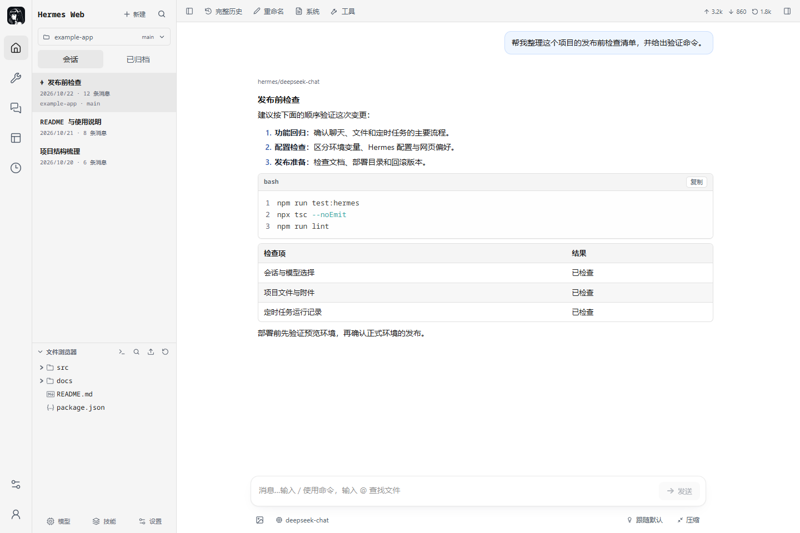
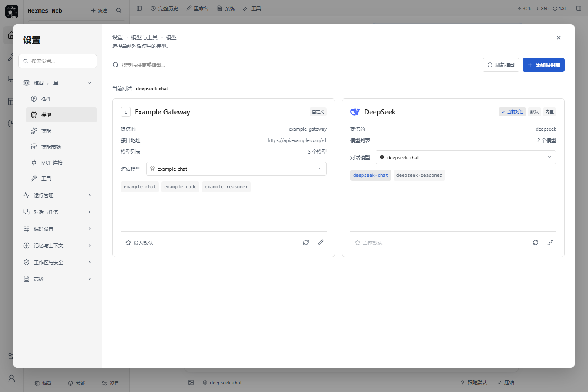
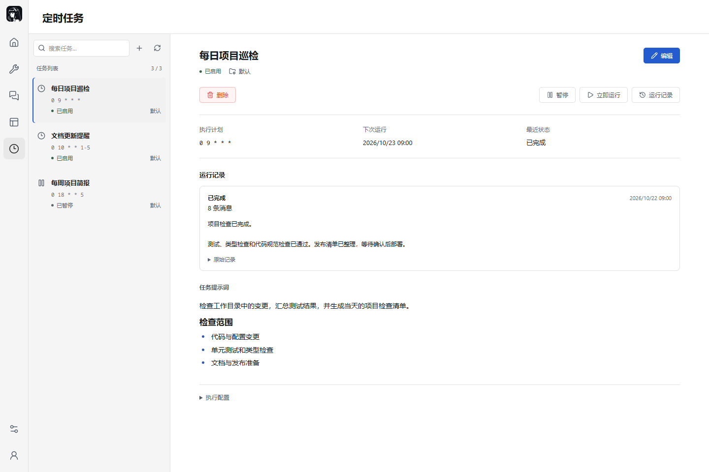

# Hermes Web

**在浏览器中使用 Hermes Agent，管理会话、项目、模型、技能与定时任务。**

A self-hosted web workspace for Hermes Agent.

**本项目基于 [agegr/pi-web](https://github.com/agegr/pi-web)（MIT License）二次开发，并非全部原创实现。** 会话界面、Markdown 渲染、文件浏览器、终端和设置组件等大量基础能力来自 Pi Web；本仓库在此基础上完成 Hermes Agent 的连接适配、管理页面和相关交互调整。

Hermes Web 支持桌面与手机访问，适合在自己的电脑或服务器上部署。原始上游版权和 MIT 许可文本保留在 [`LICENSE`](LICENSE) 中。

本项目由社区独立维护，并非 Pi Web 或 Nous Research 的官方发行版，也不代表这些上游项目为本仓库的改动提供背书。项目仍在持续开发，部分管理功能取决于已安装 Hermes 版本提供的接口。

[快速开始](#快速开始) · [功能一览](#功能一览) · [配置说明](#配置说明) · [部署](#部署) · [常见问题](#常见问题) · [MIT License](LICENSE)



> 文档截图来自真实界面，使用固定演示数据，不包含私人会话、真实凭据或真实模型调用结果。

## 功能一览

| 模块 | 已接入能力 |
| --- | --- |
| 会话与聊天 | 历史会话、全文搜索与匹配定位、置顶与归档、重命名、流式回复、推理内容、工具调用、执行确认、澄清表单、停止与断线恢复 |
| 项目工作区 | 项目目录选择、会话目录恢复、文件浏览与预览、普通文件和图片附件、拖放上传、失败重试、同名文件保护、终端与 Git 信息 |
| 模型与提供商 | 提供商卡片、模型搜索与切换、自定义接口、模型发现、当前会话选择恢复、显式设置默认模型、后端支持的账号授权与密钥配置 |
| 定时任务 | 新建与编辑、暂停与恢复、立即运行、删除、任务详情及运行记录；定时任务记录与首页普通会话分开 |
| 技能与工具 | 已安装技能、SKILL.md 预览与编辑、技能市场、安装与更新、MCP 服务器配置、连接测试与授权、插件和内置工具管理 |
| 配置与运行管理 | 基于 schema 的配置表单、YAML 编辑、配置档案、记忆与用户画像、SOUL、消息渠道、配对、Webhooks、日志与用量统计 |
| 产物与界面 | 会话产物浏览、媒体与文档预览、下载与手动保存版本、浅色与深色主题、字体与聊天显示偏好、响应式布局与 PWA |

模型选择和“设为默认”是两个操作：前者记录当前会话下一次使用的模型，刷新网页后可以恢复；后者明确修改 Hermes 的默认配置。成功运行后，以 Hermes 保存的实际会话模型和路由为准。

目前支持的会话命令为 `/compact`、`/name`、`/session` 和 `/copy`。未实现的命令会明确提示，不会作为普通消息静默发送。

<details>
<summary>查看模型管理与定时任务截图</summary>

### 模型与提供商



### 定时任务



</details>

## 快速开始

### 1. 准备环境

- **Node.js 与 npm**：建议使用 Node.js 24；仓库声明的最低版本为 `22.19.0`。
- **Hermes Agent**：已有可用的 [Hermes Agent 安装](https://github.com/NousResearch/hermes-agent)，并启用 Dashboard。普通聊天还需要 Hermes API Server。
- **模型服务**：在 Hermes 中配置好至少一个可用提供商。安装本项目不会代为创建模型账号或配置 API 额度。

最直接的部署方式是让 Hermes Web 与 Hermes 运行在同一台机器、同一文件系统中。

### 2. 安装依赖

```bash
git clone https://github.com/Keduoli03/hermes-web.git
cd hermes-web
npm ci
cp .env.example .env.local
```

PowerShell 中可用 `Copy-Item .env.example .env.local` 复制配置模板。

### 3. 配置连接与登录

编辑 `.env.local`，按自己的安装填写：

```dotenv
# Hermes 管理接口与项目聊天。端口以你的 Hermes 实际配置为准。
HERMES_DASHBOARD_URL=http://127.0.0.1:8648

# 普通聊天的 Hermes API Server，与模型提供商的 API 地址不同。
HERMES_API_SERVER_URL=http://127.0.0.1:8642
API_SERVER_KEY=replace-with-your-hermes-api-server-key

# 本网站的登录账号，与上述后端密钥相互独立。
PI_WEB_USERNAME=admin
PI_WEB_PASSWORD=replace-with-a-long-random-password
PI_WEB_ALLOWED_HOSTS=localhost,127.0.0.1
```

启动前替换示例密码和 API key。本项目没有预设管理员密码。

同机私有 Dashboard 支持自动本机握手，通常不需要手动填写 `HERMES_DASHBOARD_SESSION_TOKEN`。这里的“私有”指后端本身使用回环私有模式；仅把连接地址写成 `127.0.0.1`，不会关闭原 Dashboard 的公网登录认证。详见[私有 Dashboard 接入](docs/hermes-private-dashboard.md)。

如果暂时只使用项目聊天和管理功能，可以先配置 Dashboard；普通聊天需在 API Server 配置完成后使用。

### 4. 启动

```bash
npm run dev
```

打开 <http://127.0.0.1:30141>，登录后从左下角账号菜单进入“账号与访问”，检查管理接口、聊天接口与项目 WebSocket 的连接状态。

这三项检查相互独立。连接检查是只读探测，不会创建会话或调用模型；连接成功也不等于模型推理、目录权限和终端均已验证。

## 服务接入方式

Hermes Web 是 Web 界面与服务端适配层，智能体执行、模型配置、会话存储和任务调度仍由 Hermes 提供。

| 连接 | 负责什么 | 认证方式 |
| --- | --- | --- |
| 浏览器 → Hermes Web | 页面、文件操作及所有 Web API 的访问入口 | 本网站密码登录，或单独配置的 Nous 官方账号登录 |
| Hermes Web → Dashboard | 管理接口、项目会话与原生 WebSocket | 服务端本机握手，或后端支持的显式 Dashboard 令牌 |
| Hermes Web → API Server | 普通聊天的 Runs API 与 SSE 事件流 | 服务端保存的 `API_SERVER_KEY` |

浏览器只持有面板登录会话，不会获得上述后端认证令牌。模型提供商的密钥也不同于 `API_SERVER_KEY`：前者供 Hermes 调用模型，后者供本项目连接 Hermes API Server。

文件浏览、上传、Git 和终端作用于 **Hermes Web 所在主机**。连接另一台机器上的 Hermes，不会自动获得那台机器的文件或终端；跨机器部署需要真实共享或挂载的文件系统，以及正确的路径映射。

实现与配置归属见[架构说明](docs/hermes-architecture.md)。

## 配置说明

以下变量配置在服务端环境或忽略提交的 `.env.local` 中。完整模板见 [`.env.example`](.env.example)。

| 变量 | 用途 | 默认值或说明 |
| --- | --- | --- |
| `HERMES_DASHBOARD_URL` | Dashboard 管理接口与项目聊天地址 | `http://127.0.0.1:8648` |
| `HERMES_DASHBOARD_SESSION_TOKEN` | 显式 Dashboard 服务令牌 | 同机私有模式可留空；显式令牌不会被自动握手覆盖 |
| `HERMES_API_SERVER_URL` | 普通聊天 API Server 地址 | `http://127.0.0.1:8642` |
| `API_SERVER_KEY` | API Server 的 Bearer 凭据 | 普通聊天需要，与 Hermes 端保持一致 |
| `PI_WEB_USERNAME` | 本网站管理员用户名 | 可选；设置后与密码一同验证 |
| `PI_WEB_PASSWORD` | 本网站登录密码 | 自行设置；只配置密码时保留密码登录方式 |
| `PI_WEB_ALLOWED_HOSTS` | 允许访问的主机名 | 对外部署时填写实际域名，不带协议或路径 |
| `HERMES_WEB_DATA_DIR` | Web 私有状态与缓存目录 | `~/.hermes-web`；部署时应持久化且允许服务账号写入 |
| `HERMES_PROJECT_PATH_MAP` | 跨主机共享目录的本地/远端路径映射 | 可选；只转换路径，不负责挂载或同步文件 |

### 使用 Nous 官方账号登录

本网站可以单独注册为 Nous 登录客户端，与 Hermes 内置 Dashboard、模型提供商登录分别配置。

```dotenv
HERMES_WEB_OAUTH_CLIENT_ID=agent:your-instance-id
HERMES_WEB_PUBLIC_URL=https://hermes.example.com
PI_WEB_ALLOWED_HOSTS=hermes.example.com
```

注册的回调地址为 `https://hermes.example.com/api/web-auth/official/callback`。可通过 `HERMES_WEB_OAUTH_ALLOWED_USERS` 进一步限定精确用户 ID，也可以同时保留密码备用入口。

客户端注册、访问权限、HTTPS 与会话有效期说明见[官方登录配置](docs/hermes-official-login.md)。

## 部署

在独立发布目录中安装和构建：

```bash
npm ci
npm run build
npm run start
```

`npm run start` 默认监听 `127.0.0.1:30141`。对外访问通过 HTTPS 反向代理，保留 `Host`、支持 WebSocket，并关闭流式响应缓冲。仓库提供了[部署指南](docs/hermes-deployment.md)和 [Web 服务 systemd 模板](deploy/systemd/hermes-web.service.example)。

部署时需要明确的几个边界：

- 对外访问必须配置本网站登录。未配置认证的远程访问会被阻止；无密码回环访问仅用于本地开发。
- 登录账号共享同一套 Hermes 与主机权限，本项目不提供每个账号独立的容器、文件系统或 Hermes 实例。
- Dashboard 和 API Server 保持私有，只发布 Hermes Web 的 HTTPS 入口。
- 持久化 `HERMES_WEB_DATA_DIR`，备份 Hermes 自身数据与 Web 私有数据；元数据缓存不能替代备份。
- 活跃聊天事件与 WebSocket 归属仍在应用进程内，使用单进程部署，或为运行中的聊天保持粘性路由。
- 使用根路径部署。当前不支持将面板挂在 `/hermes` 等子路径下。

**不要在运行 `next dev` 的同一目录执行 `npm run build`**，也不要启动多个共用 `.next` 的开发进程。发布构建应使用独立目录，或先停止开发服务。

## 缓存与数据

Web 自有数据默认保存在 `~/.hermes-web`，也可以通过 `HERMES_WEB_DATA_DIR` 指定位置：

| 目录 / 位置 | 内容与生命周期 |
| --- | --- |
| `auth/` | 私有登录会话和一次性登录流程；重启后可继续读取，退出登录会撤销会话 |
| `metadata-cache/` | 模型目录、自定义接口信息、配置结构和工具列表的服务端快照及模型发现结果 |
| `artifacts/` | 可重建的产物索引；不取代 Hermes 原始会话与文件 |
| `artifact-versions/` | 手动保存的产物历史版本，需要作为用户数据备份 |
| 浏览器本地存储 | 语言、主题、显示偏好、草稿及待应用的会话模型选择 |

元数据缓存按后端身份、配置档案和完整查询参数隔离。常规列表新鲜期为 1 分钟，配置结构为 5 分钟；过期快照最多保留 1 小时，访问时后台更新。并发读取合并为一次上游请求，成功保存相关配置后失效，手动刷新强制重新获取。

密钥、原始配置值、YAML、认证状态、会话、定时任务和运行状态不使用这层元数据缓存。缓存目录不可用时，读取回退到上游接口。

浏览器刷新或短时断网可以恢复当前标签页的运行，不会自动重发提示词。事件保留至运行结束后 30 分钟；Web 进程重启后的运行恢复以已保存历史为准，不承诺跨进程恢复内存中的事件缓冲。

## 开发与测试

技术栈为 Next.js、React 和 TypeScript，复用 Pi Web 的消息、文件、终端与设置组件。Hermes 专用请求经过本项目的认证适配层，再连接官方后端。

```bash
npm run test:hermes
npx tsc --noEmit
npm run lint
```

浏览器回归使用已经启动的开发服务。先确保测试进程与开发服务使用相同的本网站测试密码；若自定义 `HERMES_WEB_DATA_DIR`，两者也需指向相同目录。

```bash
# 在专用本地测试环境中运行；开发服务也应从相同测试配置启动。
PI_WEB_PASSWORD=local-test-password npm run test:e2e -- model-persistence model-cards cron-layout
```

默认目标为 `http://127.0.0.1:30141`，测试入口见 [`e2e/run.mjs`](e2e/run.mjs)。可以用 `HERMES_TEST_URL` 修改目标，部分脚本通过 `HERMES_TEST_BROWSER` 选择浏览器；部分界面套件固定使用已安装的 Microsoft Edge。按实际脚本准备浏览器后再运行，不要将整套脚本直接当作无浏览器依赖的 CI 检查。

带 `live` 的脚本用于真实后端联调。其中既有只读探测，也有在临时档案中执行写操作的脚本；运行前阅读脚本说明。模拟接口测试通过，不代表真实模型推理、渠道投递或服务器权限已经验收。

| 路径 | 主要职责 |
| --- | --- |
| `app/` | Next.js 页面、服务端代理与 API 路由 |
| `components/Hermes*.tsx` | Hermes 会话工作区、管理页面和设置界面 |
| `hooks/` | 会话交互、附件、偏好及响应式状态 |
| `lib/hermes-*` | Hermes 连接、传输适配、缓存、配置与产物逻辑 |
| `lib/web-auth*`、`lib/web-request-auth.mjs` | 面板认证、会话与请求边界 |
| `e2e/` | 浏览器回归与真实后端联调脚本 |
| `deploy/` | 可自行替换参数的部署模板 |
| `docs/` | 架构、接入、部署与贡献说明 |

修改前请阅读 [`AGENTS.md`](AGENTS.md)、[`DESIGN.md`](DESIGN.md) 及对应的 [`docs/agents/`](docs/agents/) 模块说明。仓库仍保留部分 Pi Web 兼容代码与历史文档，Hermes 的使用和部署以本 README 与 `docs/hermes-*` 为准。

## 常见问题

**为什么页面能登录，但不能聊天或读取管理信息？**

网站登录、Dashboard 和 API Server 是三套独立连接。先在“账号与访问”分别检查状态；普通聊天需要 API Server，项目聊天需要 Dashboard WebSocket 和有效目录。

**为什么 Dashboard 地址是本机，仍然跳转到 Nous 登录？**

Dashboard 的有效 `public_url` 也会影响认证方式。保留现有公网 Dashboard 的认证，按[私有 Dashboard 接入指南](docs/hermes-private-dashboard.md)配置独立回环实例；不要通过关闭原服务认证来绕过它。

**为什么刷新后模型选择、提供商列表或缓存看起来不同？**

当前会话选择与全局默认模型分别保存；需要修改默认值时使用“设为默认”。模型管理只列出当前作用域中明确配置的提供商，其他可添加项在“添加提供商”中查看。外部修改 Hermes 配置后，可手动刷新目录以立即重取。

**定时任务记录在哪里？时间按哪个时区显示？**

在“定时任务”中选择任务即可查看运行记录，它们不会混入首页普通会话。当前管理页时间按 `Asia/Shanghai` 格式化，任务实际调度时区由 Hermes 配置决定。

**能只部署静态页面，或直接使用上游 npm 包吗？**

不能用静态托管替代本项目的 Next.js 服务端：认证、代理、文件、终端和持久状态都需要服务端运行。仓库的 npm 包名和部分元数据仍沿用上游，安装已发布的 `@agegr/pi-web` 不等于安装本 Hermes 适配版本；请按本仓库源码部署。

## 贡献

欢迎提交 Issue 和 Pull Request。问题描述请包含复现步骤、操作系统、Node.js 与 Hermes 版本，以及去除凭据后的错误信息。不要提交 `.env.local`、Cookie、模型密钥、Dashboard 令牌或私人会话截图。

功能变更请保留真实接口语义，并提供相应验证；界面变更沿用现有共享组件与主题，附上演示数据下的桌面和窄屏截图。

## 致谢与许可

- [agegr/pi-web](https://github.com/agegr/pi-web)：本仓库的上游，提供消息渲染、文件与终端组件、设置结构和基础视觉体系。
- [NousResearch/hermes-agent](https://github.com/NousResearch/hermes-agent)：智能体运行时、Dashboard、API Server 及相关协议与资产。
- [nesquena/hermes-webui](https://github.com/nesquena/hermes-webui)：认证、配置发现和运行时适配设计的参考实现。

代码沿用 [MIT License](LICENSE)，并保留上游版权声明。Hermes 头像的来源与许可见[资产说明](public/icons/HERMES-SOURCE.md)和[上游许可](public/icons/HERMES-LICENSE.txt)；字体许可见 [Noto Sans Mono OFL](public/fonts/OFL.txt)，Hermes 字段文案的许可见 [`lib/i18n/hermes/LICENSE`](lib/i18n/hermes/LICENSE)。使用相关名称和图标不代表本项目获得官方背书。

## 免责声明

本项目按“现状”（AS IS）提供，不对适用性、持续可用性、数据完整性或安全性作出保证。使用者应自行评估模型调用费用、主机权限、数据备份和对外部署风险。

来源说明用于准确标注上游贡献，不代表将本仓库新增或修改代码的维护责任归于上游。具体许可、担保排除与责任限制以 [`LICENSE`](LICENSE) 原文为准。
